# Digura

Her gün yalnızca **1 duygu rengi** ve en fazla **140 karakterlik tek bir cümle** ile ruh halini kaydettiğin; yazdığın notların **30 gün kilitli kaldığı** ve geçmişini renkli bir ısı haritası ile aylık istatistiklerden izlediğin minimalist duygu günlüğü ve dijital zaman kapsülü. Flutter ile yazılmıştır; hesap, sunucu ve internet yoktur. Kayıtlar cihazda (`shared_preferences`), PIN özeti güvenli depoda (`flutter_secure_storage`) saklanır.

| Bugün | Kayıt Onayı | Kilitli Kapsül |
| --- | --- | --- |
| 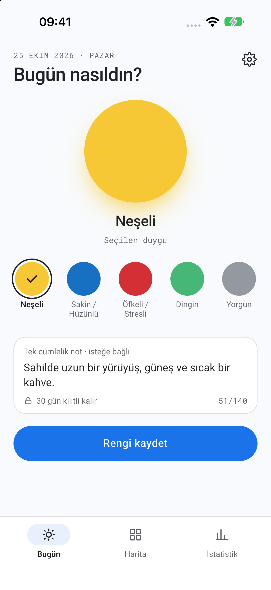 | 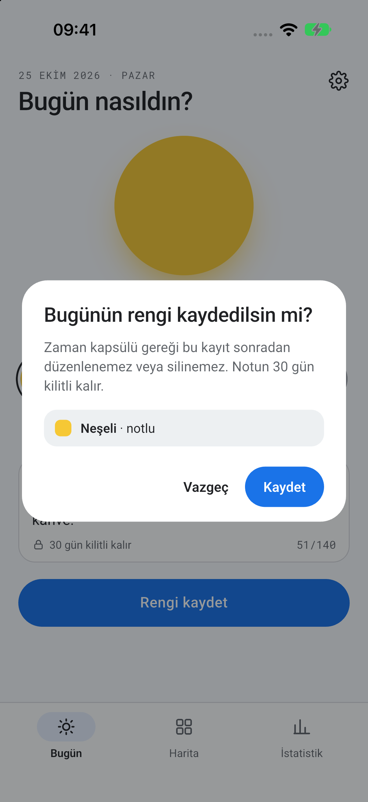 | 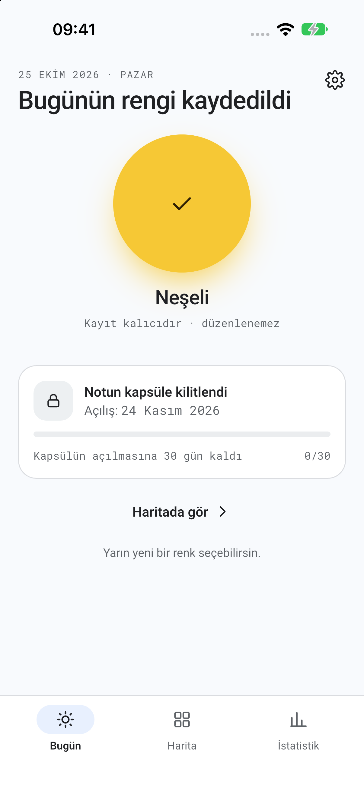 |

| Harita (Ay) | Harita (Yıl) | İstatistik |
| --- | --- | --- |
| 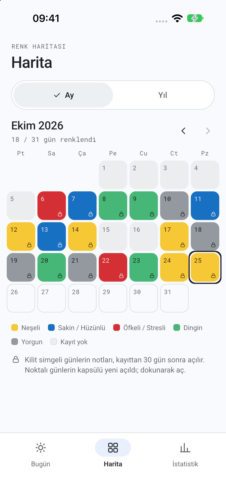 | 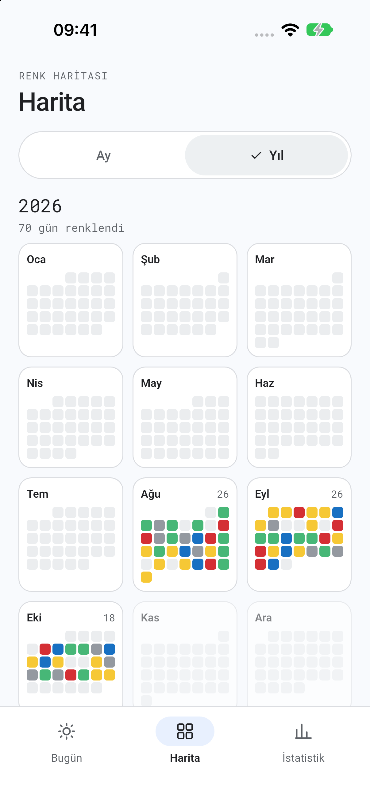 | 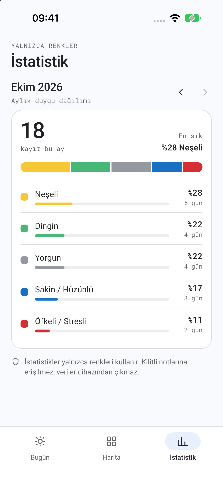 |

| Kapsül Detayı (Kilitli) | Açılan Kapsül | Yeni Açılan Günler |
| --- | --- | --- |
| 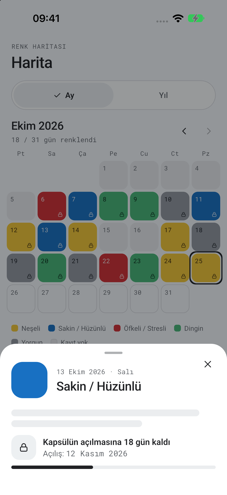 | 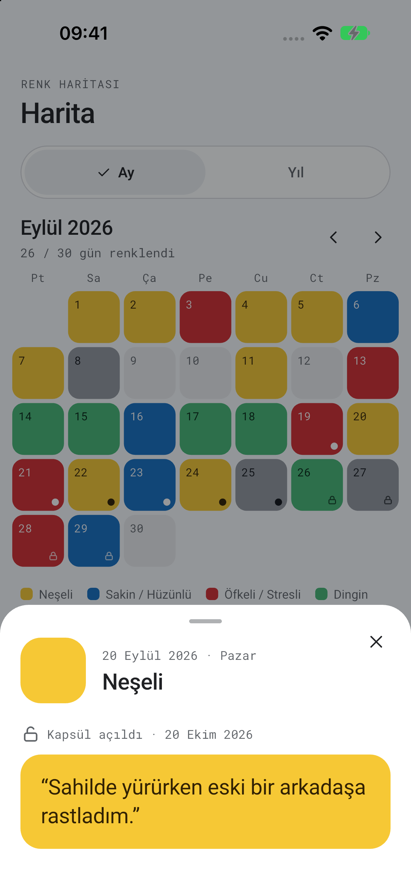 | 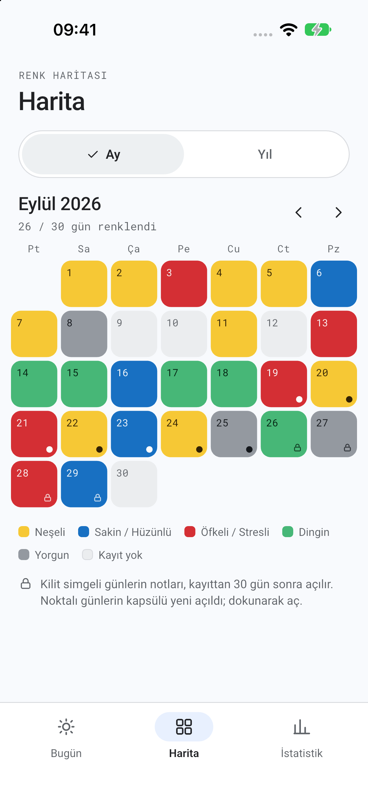 |

| Açılış Kilidi | Parmak İzi Doğrulama | PIN Kurtarılamaz |
| --- | --- | --- |
| 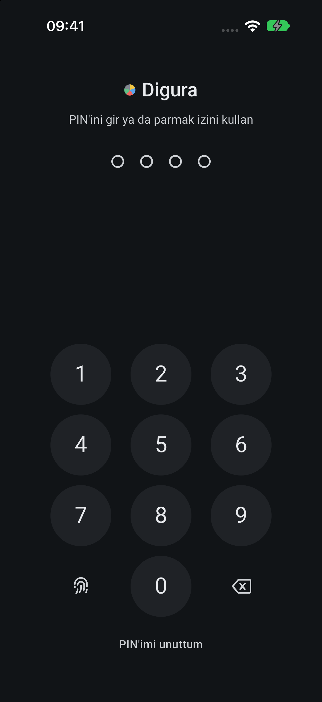 | 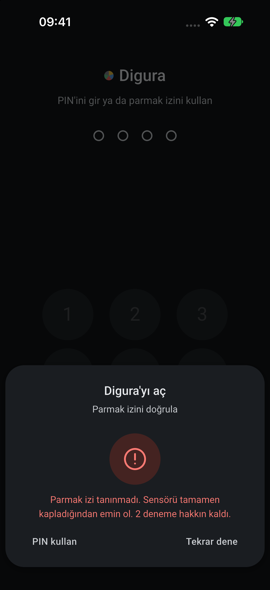 | 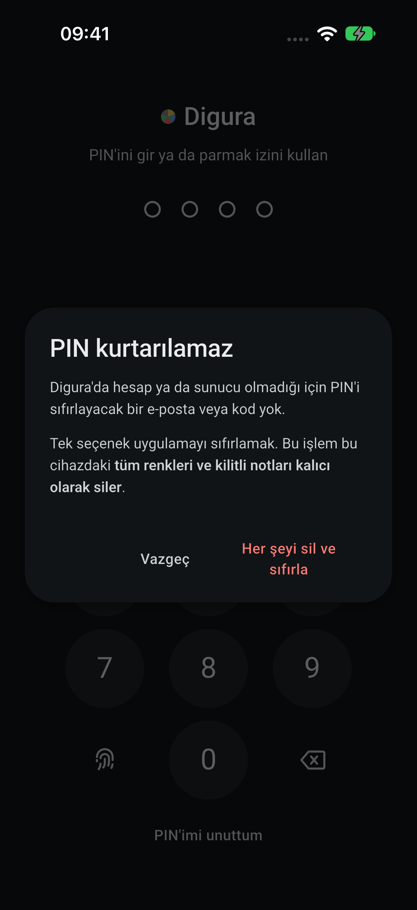 |

| Karşılama 1/3 | Karşılama 2/3 | Karşılama 3/3 |
| --- | --- | --- |
| 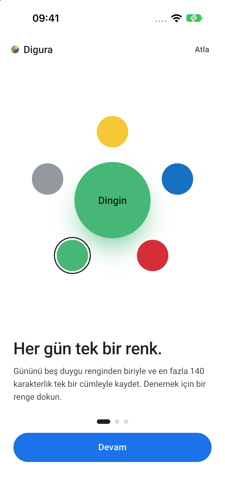 | 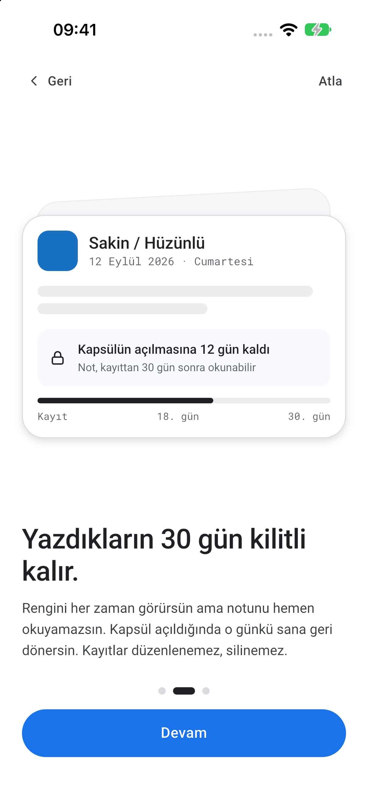 | 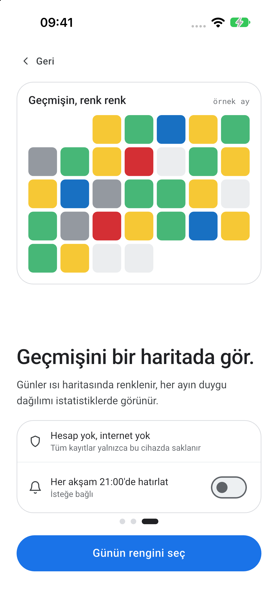 |

| Koyu Tema · Bugün | Koyu Tema · Harita | Koyu Tema · İstatistik |
| --- | --- | --- |
| 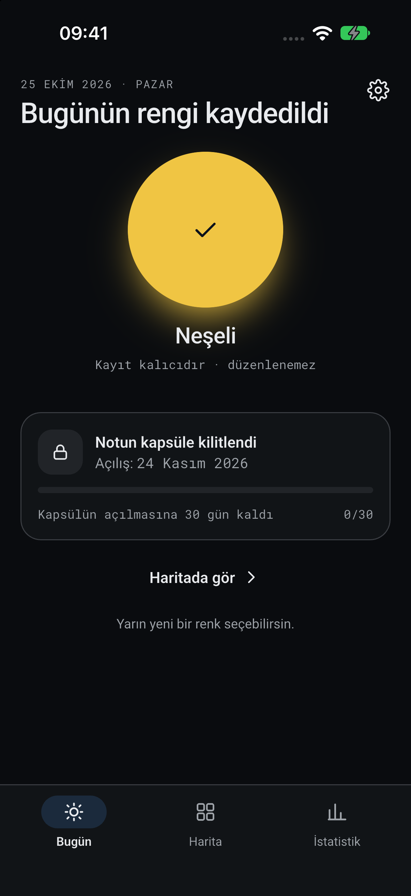 | 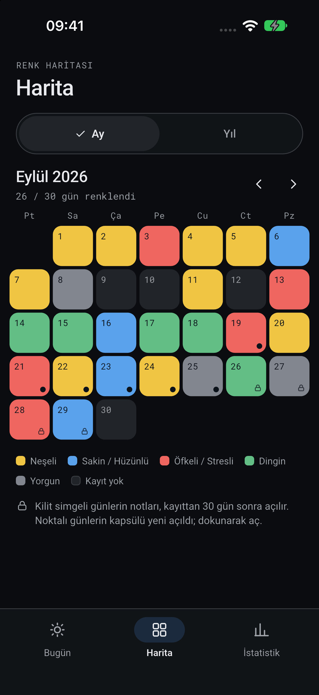 | 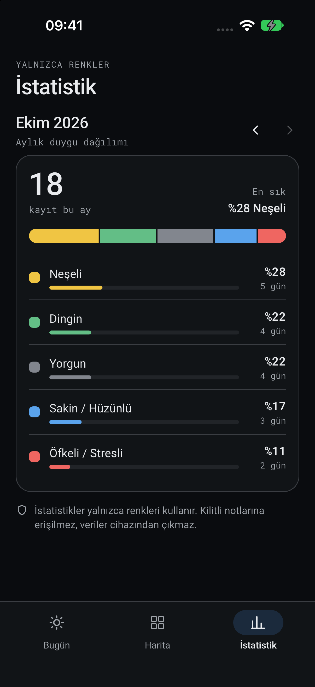 |

Ek görüntüler: [PIN oluştur](docs/screenshots/04-pin-setup.png) · [Parmak izi kurulumu](docs/screenshots/05-biometric-setup.png) · [Parmak izi açık](docs/screenshots/06-biometric-done.png) · [Renk seçilmeden Bugün](docs/screenshots/07-today.png) · [Ayarlar](docs/screenshots/17-settings.png) · [Güvenlik](docs/screenshots/18-security.png) · [Tema seçimi](docs/screenshots/19-theme.png)

## Özellikler

- **3 adımlı karşılama:** etkileşimli 5 duygu rengi çemberi, kilitli kapsül önizlemesi, örnek ay ısı haritası ve "Her akşam 21:00'de hatırlat" anahtarı
- **Cihaz içi kilit:** 4 haneli PIN (tuzlu SHA-256 özeti olarak saklanır). Ardışık (`1234`, `9876`) ve tekrarlayan (`1111`, `0000`) zayıf PIN'ler reddedilir. 5 yanlış denemede 30 sn bekleme uygulanır
- **Parmak izi (isteğe bağlı):** `local_auth` ile tek dokunuşla açılır. 3 başarısız denemede sensör geçici olarak kapanır ve PIN istenir. PIN unutulursa kurtarma yoktur; tek seçenek tüm verileri silip uygulamayı sıfırlamaktır
- **Bugün:** büyük renk dairesi, 5 duygu rengi (Neşeli, Sakin / Hüzünlü, Öfkeli / Stresli, Dingin, Yorgun) ve 140 karakterlik tek cümlelik not. Kayıt onay diyaloğundan sonra kayıt **düzenlenemez ve silinemez**; günde tek kayıt yapılır
- **Zaman kapsülü:** not 30 gün kilitli kalır. Kilitli metin widget ağacına hiç ulaşmaz (tip düzeyinde engellenir). Kart, açılış tarihini ve kalan günü ilerleme çubuğuyla gösterir. 30. gün dolduğunda kapsül dairesel açılış animasyonuyla (`CircleReveal`) açılır
- **Harita:** Ay görünümünde 7 sütunlu takvim, kilit simgeli günler ve yeni açılan kapsüller için nokta işareti var. Yıl görünümünde 12 ayın mini ısı haritası ve yıllık renklenen gün sayısı yer alır. Bir güne dokununca Kapsül Detay paneli açılır
- **İstatistik:** aylık kayıt sayısı, en sık duygu, yığılmış dağılım şeridi ve duygu başına yüzde / gün. Yalnızca renkler kullanılır; kilitli notlara erişilmez
- **Günlük hatırlatıcı:** her akşam 21:00'de yerel bildirim gelir (Android / iOS, internetsiz). Ayarlar'dan açılıp kapatılır
- **Ayarlar:** Güvenlik (PIN değiştirme, parmak izi aç/kapat), hatırlatıcı, tema (Sistem / Açık / Koyu) ve örnek veriye dönüş
- Material 3 açık ve koyu tema. Renk yalnızca beş duygudan gelir; tek mavi vurgu ana eylemdedir
- Sakin hareket dili: geçişler 300 ms altındadır ve sistemin *Hareketi Azalt* ayarına tam uyulur
- İlk açılışta örnek veri yüklenir: son ~70 güne yayılmış açılmış, yeni açılmış, notsuz ve kilitli kapsüller

## Kurulum ve çalıştırma

```bash
flutter pub get
flutter analyze
flutter test
flutter run            # bağlı cihaz / emülatör
```

Geliştirici bayrakları:

```bash
flutter run --dart-define=DIGURA_DEMO=true    # karşılamayı atlar, demo PIN 2580 ile kilitten başlar
flutter run --dart-define=DIGURA_MOCK=false   # örnek veriyi yüklemez
flutter run -t test_driver/main.dart          # Flutter Driver uzantısıyla (ekran ekran doğrulama)
```

> Not: Uygulama Android emülatöründe, iOS simülatöründe ve gerçek cihazlarda çalışır. Simülatörde kayıtlı biyometri olmadığı için parmak izi akışı prototipteki demo sensörle çalışır; gerçek cihazda `local_auth` kullanılır. iOS en düşük sürümü 15.0'dır.

İkon veya açılış ekranı dosyaları değişirse:

```bash
dart run flutter_launcher_icons
dart run flutter_native_splash:create
```

## Mimari

Klasör yapısı `lib/core` + `lib/features/<feature>/{controllers,models,views,widgets}` şeklindedir. Özellikler: `onboarding`, `app_lock`, `home`, `mood_entry`, `mood_calendar`, `mood_stats`, `settings`. State `ValueNotifier` + `ValueListenableBuilder` ile yönetilir; bağımlılıklar `InheritedWidget` tabanlı `AppScope` ile paylaşılır. Harici state, DI, router, animasyon veya takvim paketi kullanılmaz. Renk, süre ve metinler yalnızca `AppColors` / `AppMotion` / `AppStrings` jetonlarından gelir. Ayrıntılar: [PROJECT_NEW.md](PROJECT_NEW.md), [.agents/skills/flutter-development/SKILL.md](.agents/skills/flutter-development/SKILL.md). Tasarım ve hareket kaynakları: [design/DESIGN.md](design/DESIGN.md), [design/ANIMATION.md](design/ANIMATION.md). Geliştirme günlüğü ve kararlar: [DONE.md](DONE.md).

## Notlar

- Uygulama hiçbir ağ isteği yapmaz; tüm kayıtlar, PIN ve parmak izi ayarı yalnızca cihazda tutulur. Parmak izi verisi uygulamaya ulaşmaz, eşleştirmeyi işletim sistemi yapar.
- Yazı tipleri (Roboto, Roboto Mono) çevrimdışı kullanım için pakete gömülüdür (`assets/fonts/`).
- iOS'ta Face ID izin metni `ios/Runner/Info.plist` içinde, Android'de biyometri ve bildirim izinleri `android/app/src/main/AndroidManifest.xml` içindedir.
